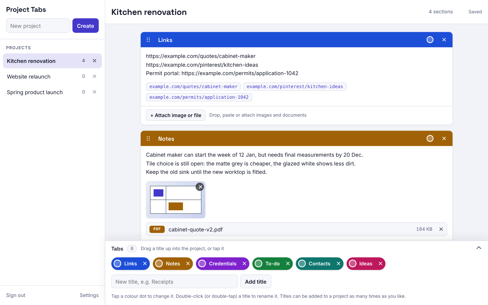
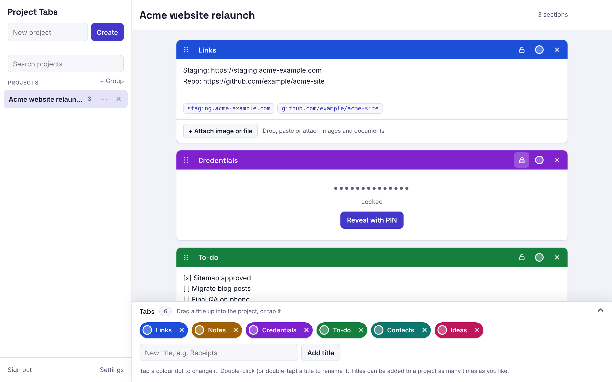
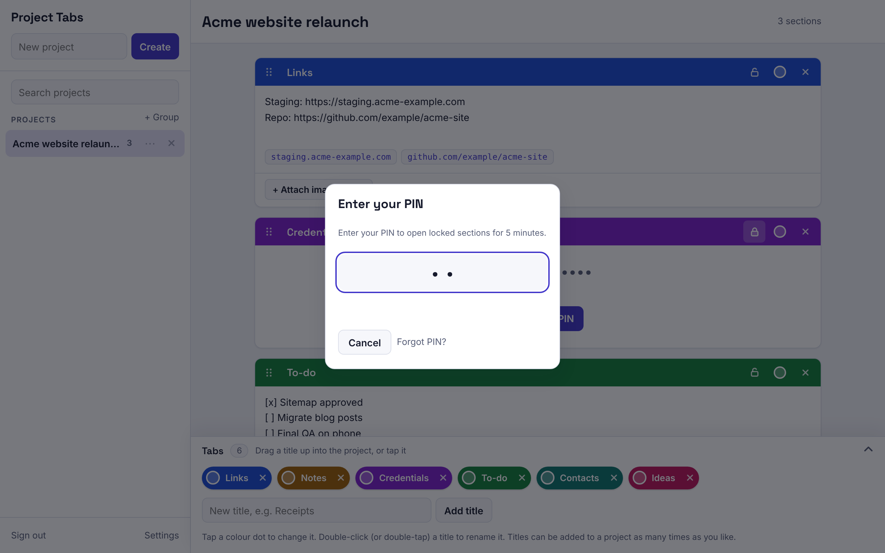
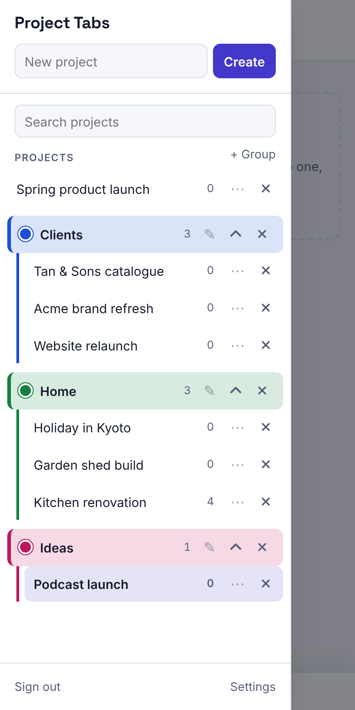

# Project Tabs

A small, private, self-hosted notebook for keeping everything about a project in one place: links, notes, credentials, to-dos, images and documents. Runs on ordinary PHP + MySQL hosting (cPanel is fine) and installs on your phone as a PWA.

## How it works

- Create projects in the left list.
- Open a project and slide up the **Tabs** tray. Each tab is a coloured title (Notes, Links, To-do, anything you create).
- Drag a title into the project, or just tap it. The same title can be added as many times as you like.
- Every section is a plain-text box that grows as you type. Links become clickable.
- Attach images and documents to any section by drag and drop, paste, or the attach button.

 

  

## Features

- **Project groups**: coloured, collapsible groups in the project list (drag a project onto a group, or use the ⋯ menu), plus a search box
- **PIN lock for sections**: lock any section (e.g. Credentials) behind a 6-digit PIN. It stays masked until you enter the PIN, then re-locks after 5 minutes. Wrong guesses are throttled; a forgotten PIN is reset with your password plus a 2FA code.
- Single user, password login with optional 2FA (any authenticator app) and recovery codes
- Reusable, recolourable tab titles; light and dark themes
- Autosave, image downscaling, lightbox viewer
- Installable on iOS and Android (PWA)
- **Export** everything as a zip (JSON + readable Markdown + your files)
- **Automatic backup to Google Drive** via a cPanel cron job, keeping the newest N backups

## Requirements

PHP 7.4+ (with PDO MySQL, ZipArchive, cURL, fileinfo), MySQL/MariaDB, HTTPS.

## Install

1. Upload the files to a folder on your host.
2. Create a MySQL database and user in cPanel.
3. Copy `config.sample.php` to `config.php` and fill in your details.
4. Open `setup.php` in your browser once, enter your setup key, and create your account.

Full steps, Google Drive setup, cron and troubleshooting are in [INSTALL.md](INSTALL.md).

## Limitations

- One user only, by design.
- Backups can be exported and stored, but there is no in-app Restore button yet.
- Plain text only (no rich formatting).
- The PIN lock hides sections but does not encrypt them: the database, exports and Google Drive backups hold the text as plain text, so keep those private.

## Roadmap

If this reaches **100 downloads**, I'll build:

1. **Multiple user logins**, so a small team can each have their own account.
2. **Cloud hosting**, so you can use Project Tabs without setting up your own server.

## Need help setting it up?

Stuck on cPanel, the database, HTTPS or the Google Drive backup? Book me for a **$10 coffee** and I'll help you get it running.
Email: soorajfq@gmail.com

## License

MIT. See [LICENSE](LICENSE) and [THIRD_PARTY_NOTICES.md](THIRD_PARTY_NOTICES.md).
